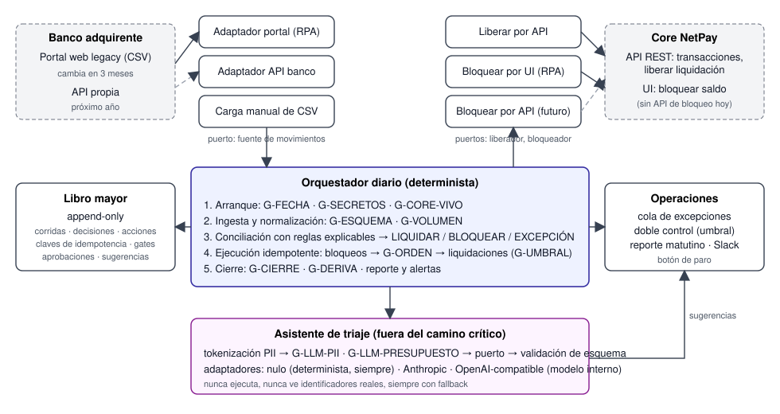

<div class="portada" markdown="1">
<div class="sup">Spin by OXXO · Proceso de selección · Forward Deployed Engineer (IC3)</div>

# Operación Escaldada

<div class="sub">Automatización end-to-end de contracargos y liquidación: solución, protección del dinero, IA con criterio y plan de puesta en producción</div>

<div class="meta">
<b>Candidato:</b> Edgar Alberto Sanabria Paredes<br>
<b>Fecha:</b> 16 de octubre de 2026<br>
<b>Entregables:</b> este documento y un prototipo funcional en Python (repositorio adjunto)<br>
<b>Contacto:</b> ragdeblack@gmail.com · linkedin.com/in/edgarsanp
</div>
</div>

[[SALTO]]

## Contenido

<div class="toc" markdown="1">
[TOC]
</div>

[[SALTO]]

## 1. Resumen ejecutivo

**El problema no es la velocidad de los analistas: es que hay un humano en el camino crítico de cada transacción.** Con un volumen que creció 300 %, ese humano es el cuello de botella, y las consecuencias son concretas: comercios reclamando su dinero cada mañana y pérdidas cuando un contracargo no se bloquea a tiempo.

**La solución** es un pipeline diario, determinista y auditable, que saca al humano del camino feliz y lo deja únicamente donde aporta: en las excepciones y en las decisiones de alto monto. Ingresa los movimientos del banco por un adaptador intercambiable (hoy automatización del portal legacy, mañana la API del banco), concilia contra el Core con reglas explicables, ejecuta las acciones de forma idempotente, bloquea contracargos antes de liberar una sola liquidación, y manda a una cola de revisión asistida por IA todo lo que no cuadra.

**Lo que entrego** no es solo un diseño. Construí un prototipo funcional que corre de punta a punta contra un portal bancario y un Core simulados: descarga el CSV con un robot sobre el portal, concilia 186 movimientos con todos los casos feos (duplicados, montos distintos, contracargos sobre ventas ya liquidadas, acumulación anómala, cambio de esquema del portal), bloquea saldos por la interfaz del Core dejando captura de evidencia, libera liquidaciones por API con clave de idempotencia y produce el reporte matutino. Todo en menos de 10 segundos y con 31 pruebas automatizadas.

**Cómo llega a producción**, que es la parte que decide si esto funciona o se queda en diapositiva: tres fases con criterios de salida medibles. *Sombra* (semanas 1 a 3): el pipeline corre cada mañana y se compara con lo que hizo el analista, sin tocar dinero. *Asistida* (semanas 4 a 6): el pipeline propone y el analista aprueba en lote. *Autónoma* (desde la semana 7): ejecuta sola bajo umbrales, el humano solo ve excepciones y montos altos. El cambio de portal del banco en tres meses y su API del próximo año son cambios de adaptador, no proyectos.

<div class="caja" markdown="1">
**Métricas de éxito propuestas.** Liquidación del día liberada antes de las 06:00 (hoy: cuando el analista termina). Más del 95 % de movimientos conciliados sin intervención humana. Contracargos bloqueados en menos de 15 minutos desde la ejecución. Cero liquidaciones duplicadas, con evidencia auditable.
</div>

**Tres principios que atraviesan todo el diseño:**

1. **El dinero lo mueven reglas deterministas**, con idempotencia, orden y auditoría. Ningún modelo de lenguaje decide liberar o bloquear.
2. **La IA acelera al humano en las excepciones y acelera al equipo en la construcción**, siempre fuera del camino crítico, sin datos personales, con presupuesto y con fallback.
3. **Todo lo que va a cambiar está detrás de un puerto**: el portal, la API del banco, la UI del Core, el proveedor de IA. Cambiarlos es configuración, no reescritura.

[[SALTO]]

## 2. Discovery: entender el problema antes de resolverlo

### 2.1 El proceso de hoy, visto como sistema

| Paso | Quién | Herramienta | Riesgo |
|---|---|---|---|
| Descargar el CSV del día anterior | Analista | Portal web legacy, sin API | Portal cambia en 3 meses; depende de que alguien esté a las 05:00 |
| Cruzar contra el Core | Analista | Excel masivo | Errores de captura; sin trazabilidad; no escala con el volumen |
| Escenario A: liberar liquidación | Analista | API REST interna | Riesgo de duplicar o de liberar a un comercio con contracargo |
| Escenario B: bloquear saldo por contracargo | Analista | UI del Core | Es donde se pierde dinero si llega tarde |

Cuatro observaciones salen de esta tabla y definen la solución:

- **El trabajo del analista es 90 % mecánico y 10 % juicio.** Descargar, cruzar y ejecutar se puede codificar; decidir qué hacer con una diferencia de monto o una referencia que no existe, no siempre.
- **Los dos escenarios no pesan igual.** Una liquidación tarde es una queja; un contracargo sin bloquear es una pérdida. El orden de ejecución tiene que reflejarlo: contracargos primero, siempre.
- **El Core ya tiene API para liberar, pero no para bloquear.** Esa asimetría define qué se automatiza por API y qué por interfaz, y cuál es la primera petición que haría al equipo del Core.
- **El banco va a cambiar dos veces** (portal en 3 meses, API en un año). Cualquier solución pegada al portal de hoy nace con fecha de caducidad.

### 2.2 Causa raíz

El proceso tiene a una persona en el camino crítico de cada una de las transacciones, y el volumen se triplicó. No es un problema de capacitación ni de más analistas: es un problema de diseño del proceso. La solución tiene que invertirlo: **por defecto el sistema actúa y la persona supervisa; solo cuando hay duda, la persona decide.**

### 2.3 Preguntas que haría al negocio antes de la primera línea de código

Las listo con el supuesto que tomé para el prototipo, porque un Forward Deployed Engineer no espera a tener todas las respuestas para empezar, pero sí las deja explícitas.

| Pregunta | Por qué importa | Supuesto en el prototipo |
|---|---|---|
| ¿El banco puede entregar el CSV por SFTP o correo, además del portal? | Eliminaría el robot sobre el portal desde el día uno | No; se automatiza el portal, con carga manual como respaldo |
| ¿Qué tolerancias aplica hoy el analista (monto, días de desfase)? | Son las reglas reales; hay que codificarlas, no inventarlas | Monto exacto, 1 día de desfase; ambos configurables |
| ¿Se libera la liquidación de un comercio que ese mismo día recibió un contracargo? | Decide si retener o liberar el resto de sus ventas | Se retiene y lo decide un humano (regla configurable) |
| ¿Qué monto exige doble aprobación y quién aprueba? | Define el umbral de doble control | $50,000 MXN; supervisor de Operaciones |
| ¿Puede el equipo del Core exponer una API de bloqueo? | Elimina el robot sobre la UI del Core | No hoy; se diseña el adaptador para cuando exista |
| ¿Qué es "a tiempo" para un contracargo? | Define la métrica y la alerta | Antes de las 06:00, menos de 15 min desde la corrida |
| ¿Hay más de un banco adquirente? | Cada banco es un adaptador más sobre el mismo puerto | Uno; el diseño soporta N |

### 2.4 Métricas de éxito

| Métrica | Hoy (estimado) | Objetivo | Cómo se mide |
|---|---|---|---|
| Hora en que queda liberada la liquidación del día | Cuando el analista termina, con retrasos crecientes | Antes de las 06:00 | Gate G-LATENCIA en cada corrida |
| Movimientos conciliados sin intervención humana | 0 % | > 95 % | Resumen del libro mayor |
| Tiempo entre reporte del contracargo y bloqueo del saldo | Horas, variable | < 15 min desde la corrida | Marca de tiempo por acción |
| Liquidaciones duplicadas o a comercios con contracargo | Desconocido (sin trazabilidad) | 0 | Claves de idempotencia y gate G-CIERRE |
| Horas de analista por día en conciliación | Mañana completa | < 30 min (solo excepciones) | Encuesta y tamaño de la cola de excepciones |
| Coincidencia con el criterio del analista (fase sombra) | n/a | > 98 % durante 3 semanas | Gate G-SOMBRA |

[[SALTO]]

## 3. La solución

### 3.1 Arquitectura

<figure>

<figcaption>Puertos y adaptadores: lo que va a cambiar (portal, API del banco, UI del Core, proveedor de IA) queda fuera del núcleo.</figcaption>
</figure>

Cinco piezas:

1. **Ingesta (puerto "fuente de movimientos del banco").** Hoy, un adaptador que entra al portal con un navegador automatizado, descarga el CSV y lo normaliza al modelo interno. Los selectores de la página son configuración, no código, y un test de contrato diario avisa cuando el portal cambia. Cuando el banco libere su API, se activa el segundo adaptador con una variable de entorno. Siempre existe el tercero: carga manual del CSV, para que el pipeline nunca dependa de que el robot funcione.
2. **Conciliación.** Un motor de reglas puro, sin red y sin IA, que cruza cada movimiento contra el Core por referencia, monto y fecha, con tolerancias configurables. Cada movimiento sale clasificado como LIQUIDAR, BLOQUEAR, EXCEPCIÓN con motivo, o YA PROCESADO, y lleva la regla que lo produjo. Un auditor puede explicar cualquier decisión sin leer código.
3. **Ejecución (puertos "liberador" y "bloqueador").** Liberar usa la API REST existente con clave de idempotencia. Bloquear usa hoy la UI del Core por automatización, dejando una captura de pantalla como evidencia, y mañana la API cuando exista. Los contracargos se procesan primero; un gate impide que arranque cualquier liquidación mientras quede un bloqueo sin intentar.
4. **Excepciones y control humano.** Lo que no cuadra va a una cola con contexto suficiente para resolver en segundos, priorizada por riesgo (contracargos sin match primero). Montos sobre el umbral y comercios con acumulación anómala de contracargos exigen doble aprobación. Aquí entra el asistente de IA: resume la excepción y sugiere la causa probable; la persona decide.
5. **Operación.** Libro mayor append-only (qué se decidió, qué se ejecutó, con qué evidencia), reintentos con control de errores, alertas a Slack, reporte matutino para Operaciones, modo degradado y botón de paro.

### 3.2 El flujo diario, paso a paso

| # | Paso | Gates | Si falla |
|---|---|---|---|
| 1 | Arranque a las 05:00 | G-FECHA (no se concilia el día en curso), G-SECRETOS (credenciales desde el gestor, nunca placeholders), G-CORE-VIVO | No se toca nada; alerta crítica |
| 2 | Ingesta del CSV por el adaptador activo | G-ESQUEMA (columnas, tipos, moneda), G-VOLUMEN (ni vacío ni más de 3× el promedio) | Detiene; Operaciones puede continuar con carga manual |
| 3 | Normalización (montos a centavos enteros, fechas, referencias) | | |
| 4 | Conciliación con reglas | G-DUPLICADO (claves ya confirmadas en corridas previas se omiten) | |
| 5 | Registro de todas las decisiones en el libro mayor | | |
| 6 | Ejecución de bloqueos (contracargos) | G-UMBRAL (monto alto o acumulación → doble control) | La acción queda FALLIDA con rastro; el cierre lo marca |
| 7 | Verificación de orden | G-ORDEN (ningún bloqueo pendiente de intentar) | No arrancan liquidaciones |
| 8 | Ejecución de liquidaciones | G-UMBRAL | Igual que 6 |
| 9 | Triaje de excepciones con el asistente | G-LLM-PII, G-LLM-PRESUPUESTO, G-LLM-ESQUEMA (no críticos) | El analista trabaja sin sugerencia; nada se detiene |
| 10 | Cierre | G-CIERRE (todo con estado final consistente), G-DERIVA (tasa de excepciones anómala), G-LATENCIA | Alerta; corrida marcada para revisión |
| 11 | Reporte matutino y notificación | | |

### 3.3 Tres modos de operación

| Modo | Qué hace | Para qué sirve |
|---|---|---|
| **Sombra** | Ingesta, concilia, clasifica y registra. No toca el Core. Un comando compara después lo que habría hecho contra lo que hizo el analista | Ganar confianza con datos reales sin riesgo; calibrar reglas y tolerancias |
| **Asistida** | Todo queda como "pendiente de aprobación". El supervisor aprueba en lote o por decisión, y entonces se ejecuta | Primeras semanas con dinero real: el humano sigue teniendo la última palabra en todo |
| **Autónoma** | Ejecuta bajo umbrales. Lo que supera el umbral o acumula contracargos queda pendiente de aprobación. El humano solo ve excepciones | Estado objetivo |

El cambio de modo es una variable de entorno y queda registrado en cada corrida.

### 3.4 Reglas de conciliación

Las reglas son el conocimiento del analista hecho código. En discovery se extraen del Excel y de entrevistas (ahí sí uso IA para acelerar el levantamiento, ver sección 5), se validan con Operaciones y se prueban una por una.

| Regla | Condición | Resultado |
|---|---|---|
| R0 | Misma referencia y tipo repetida en el archivo | EXCEPCIÓN · duplicado en archivo |
| R1 | Referencia sin transacción en el Core | EXCEPCIÓN · sin match (con candidatos parecidos del mismo comercio: misma referencia parcial o mismo monto en ±3 días). Si es contracargo: prioridad máxima |
| R2 | Moneda distinta | EXCEPCIÓN |
| R3 | Contracargo sobre comercio ya bloqueado | YA PROCESADO |
| R4 | Contracargo con match | BLOQUEAR. Parcial si el monto difiere; urgente si la venta ya estaba liquidada. Doble control si supera el umbral o si el comercio acumula más de 3 contracargos en el día |
| R5 | Venta con monto fuera de tolerancia | EXCEPCIÓN · monto diferente |
| R6 | Fecha fuera de la tolerancia de días | EXCEPCIÓN · fecha fuera de rango |
| R7 | Venta ya liquidada en el Core | YA PROCESADO (el analista o una corrida previa ya lo hizo) |
| R8 | Venta de comercio con saldo bloqueado | EXCEPCIÓN · no se libera sin revisión |
| R8b | Venta de comercio que hoy trae contracargo | EXCEPCIÓN · se bloquea primero y un humano decide si liberar el resto |
| R9 | Match exacto, pendiente de liquidación | LIQUIDAR. Doble control si supera el umbral |

La regla R8b no estaba en mi diseño inicial: la descubrió la prueba de integración, cuando el Core simulado rechazó liberar ventas de un comercio recién bloqueado. Preferí convertirla en regla explícita y configurable a dejar que falle en ejecución. Es exactamente el tipo de decisión que se valida con Operaciones en la fase sombra.

### 3.5 Qué es determinista y qué se delega a un modelo

| Determinista (siempre) | Modelo de lenguaje (hoy) | Modelo de lenguaje (cuando haya datos para medirlo) | Nunca un modelo |
|---|---|---|---|
| Ingesta, parseo, validación de esquema | Triaje de excepciones: causa probable y acción sugerida, en JSON acotado | Proponer reglas nuevas cuando una excepción se repite con la misma resolución humana (se promueve a código tras revisión y pruebas) | Decidir liberar o bloquear |
| Normalización y deduplicación | Resumen matutino en lenguaje natural sobre el reporte determinista | Leer evidencia no estructurada (cartas de disputa, PDFs del banco) | Llamar al Core |
| Conciliación y clasificación | Extracción de reglas en discovery a partir del Excel del analista (se usa una vez; lo que sale es código probado) | | Modificar reglas en producción sin humano |
| Ejecución, idempotencia, orden | | | |
| Umbrales, volumen, cierre, auditoría | | | |

[[SALTO]]

## 4. Protección del dinero y seguridad

Es una operación con dinero real. Separo la seguridad en capas porque son problemas distintos con controles distintos.

### 4.1 Integridad financiera

- **Idempotencia en toda acción.** Cada liquidación y cada bloqueo lleva una clave única derivada del movimiento (`LIQ:referencia:fecha`, `BLQ:referencia:fecha`). Se manda al Core como `Idempotency-Key` y se guarda en el libro mayor. Si el proceso se reinicia o la corrida se repite, no se ejecuta nada dos veces: lo demuestra una prueba que repite la corrida contra un Core que devuelve estados atrasados.
- **Rastro antes y después.** El libro mayor escribe `INTENTADA` antes de llamar al Core y `CONFIRMADA` o `FALLIDA` después. Si el proceso muere a la mitad, se sabe exactamente qué quedó en el aire.
- **Orden: contracargos primero.** El gate G-ORDEN impide que arranque cualquier liquidación mientras exista un bloqueo sin intentar.
- **Doble control.** Montos sobre el umbral y comercios con acumulación anómala de contracargos no se ejecutan solos. Quedan pendientes y un supervisor los aprueba con su nombre registrado.
- **Límites de volumen.** Si el archivo trae cero movimientos o más del triple del promedio histórico, el pipeline se detiene y pide confirmación en vez de actuar sobre datos sospechosos.
- **Conciliación de cierre.** Al terminar, G-CIERRE verifica que toda acción tenga estado final consistente. Cualquier diferencia es alerta y la corrida queda marcada.
- **Dinero en centavos enteros.** Nunca flotantes.

### 4.2 Acceso y credenciales

- Credenciales del portal, de la UI y de la API del Core en un gestor de secretos (Vault, AWS Secrets Manager o Secrets de Kubernetes), inyectadas como variables de entorno al contenedor. Nunca en código ni en archivos de configuración. El gate G-SECRETOS rechaza arrancar con credenciales ausentes o con valores placeholder.
- Usuario de servicio dedicado para el robot, separado de los analistas, con permisos mínimos y rotación. Así la auditoría del Core distingue lo que hizo el sistema de lo que hizo una persona.
- Comunicación cifrada; CSV y capturas cifrados en reposo, con retención definida con Riesgos, porque contienen datos de comercios y tarjetas enmascaradas.
- El contenedor corre sin privilegios de root.

### 4.3 Auditoría y trazabilidad

Cada decisión queda con el movimiento de entrada, la regla aplicada, la acción ejecutada, la respuesta del Core, la evidencia (captura de pantalla en acciones por UI) y, si hubo intervención humana, quién aprobó y cuándo. El registro es solo de inserción y exportable para Auditoría y Riesgos. Las sugerencias del asistente de IA también quedan registradas junto con la decisión final del humano.

### 4.4 Continuidad y operación

- **Degradación explícita.** Si falla el portal, Operaciones sube el CSV a mano y el pipeline sigue desde la normalización. Si falla el Core, se detiene sin tocar nada.
- **Botón de paro.** Cambiar el modo a sombra o suspender la tarea programada no requiere a Tecnología.
- **Alerta por ausencia.** Si a las 05:30 no hay una corrida exitosa, suena la alarma aunque nada haya fallado explícitamente.
- **Reintentos acotados** con control de errores: un 503 del Core se reintenta; un 422 (comercio bloqueado) no, y queda como excepción.

### 4.5 Qué entra en la primera etapa

En modo sombra no se toca dinero, así que la seguridad se concentra en no romper nada mientras se gana confianza: idempotencia y libro mayor desde el día uno (no se negocian), secretos en gestor y usuario de servicio, trazabilidad completa de cada decisión, umbrales y límites configurados aunque solo generen alertas, y paro manual. Para etapas siguientes: doble aprobación en flujo real, capturas de evidencia por acción, rotación automática de credenciales y endurecimiento del entorno de ejecución.

[[SALTO]]

## 5. IA con criterio

### 5.1 Dónde entra y dónde no

La IA no toca el dinero. Entra en tres lugares, todos fuera del camino crítico:

- **Triaje de excepciones (producción, diario).** Para cada movimiento que no cuadró, el asistente recibe un paquete pequeño y tokenizado y devuelve causa probable, acción sugerida de un catálogo cerrado, confianza y una explicación de tres frases. Convierte la cola de excepciones de "lista de errores" a "lista de decisiones de diez segundos".
- **Discovery (una vez).** Extraer del Excel del analista y de las entrevistas las reglas de conciliación reales, para codificarlas y probarlas. Recorta semanas de levantamiento.
- **Construcción del sistema.** Este prototipo se construyó en un día con mi flujo de desarrollo asistido por IA con gates de calidad y pruebas; es parte de por qué el MVP cabe en dos o tres semanas y no en dos meses.

### 5.2 Qué modelo y cuánto cuesta

| Tarea | Modelo de referencia | Costo estimado |
|---|---|---|
| Triaje de excepciones (diario) | Claude Sonnet 5.5 (2 USD / 10 USD por millón de tokens de entrada / salida) | ~100 excepciones × 2 mil tokens ≈ 0.40 USD de entrada al día, más salida corta |
| Resumen matutino | Claude Sonnet 5.5 | Centavos |
| Extracción de reglas en discovery | Claude Opus 5.5 | Una sola vez |
| Propuesta de reglas nuevas (futuro, semanal) | Claude Sonnet 5.5 | Centavos |

La IA bien colocada cuesta centavos porque recibe paquetes pequeños y hace tareas acotadas. Deliberadamente no uso el modelo más pequeño de la familia: tiene fecha de retiro anunciada, y ese riesgo es justo el que la siguiente sección elimina por diseño.

### 5.3 Agnóstico al proveedor

El retiro de un modelo, un cambio de precio o una exigencia de Riesgos no pueden detener el triaje. Por eso el modelo va detrás de un puerto:

- **Puerto `AsistenteTriaje`** con un solo método: recibe un `ContextoExcepcion` y devuelve una `SugerenciaTriaje` validada contra un esquema. El dominio nunca ve un prompt ni un SDK.
- **Adaptadores**: Anthropic (SDK oficial con salida estructurada), OpenAI-compatible (cualquier servidor con esa interfaz, incluido un modelo abierto dentro del perímetro de Spin) y nulo (sugerencia determinista por motivo, siempre disponible). Cambiar de proveedor es cambiar `LLM_PROVEEDOR`; cambiar de modelo es cambiar `LLM_MODELO`.
- **Prompts y contexto de negocio como artefactos versionados** en el repositorio, no en código. El libro mayor registra qué versión de prompt y qué modelo produjo cada sugerencia.
- **Salida estructurada obligatoria.** Si la respuesta no valida contra el esquema o la acción no está en el catálogo, se descarta y entra el fallback. El dominio no depende de las peculiaridades de formato de ningún proveedor.
- **Set de evaluación propio**: 30 a 50 excepciones reales con la resolución correcta del analista. Cada cambio de prompt, modelo o proveedor se corre contra ese set antes de desplegar (gate G-LLM-EVAL). Eso es lo que hace real lo "agnóstico": no que cualquier modelo sirva, sino que se puede medir cuál sirve.
- **Ciclo de vida de modelos** como procedimiento con dueño: el adaptador consulta el catálogo del proveedor y la evaluación contra el modelo sucesor se corre antes de la fecha de retiro, no después.

### 5.4 Contexto de negocio en tres capas

El asistente no redescubre nada: el sistema le entrega el contexto masticado.

| Capa | Contenido | Quién la mantiene | Cómo viaja |
|---|---|---|---|
| Fija (cambia poco) | Glosario, reglas vigentes en lenguaje claro, catálogo de motivos, catálogo de acciones sugeribles, lo que nunca hace | Operaciones + ingeniería, versionada en el repositorio | Como bloque de sistema con caché de prompt |
| Por excepción (volátil) | El movimiento, los 3 a 5 candidatos más cercanos del Core calculados por código, las reglas que fallaron y por qué, contracargos del comercio ese día | Código determinista, por excepción | Paquete JSON de menos de 1,500 tokens |
| Aprendizaje (opcional) | Las 5 excepciones pasadas más parecidas con cómo las resolvió el analista | Libro mayor | Dentro del paquete, si cabe |

El modelo nunca recibe el CSV completo ni consulta la base del Core.

### 5.5 Tokenización y presupuesto

**Tokenización de datos sensibles.** Antes de armar el paquete, un paso determinista sustituye identificadores por tokens opacos: el comercio se vuelve `COMERCIO_1`, la referencia `REF_3`, la tarjeta desaparece. La tabla de correspondencia vive en memoria y muere con la corrida. El modelo razona sobre montos, fechas y diferencias; si la sugerencia menciona `COMERCIO_1`, se destokeniza al mostrarla al analista. Un gate (G-LLM-PII) busca patrones de tarjetas, CLABE, CURP y correos en el paquete y bloquea la llamada si encuentra alguno. Una prueba automatizada verifica que ningún identificador real llega al paquete.

**Tokens del modelo.** El contexto fijo viaja con caché de prompt (se paga completo una vez y el resto a una fracción). El paquete por excepción tiene tope duro: si los candidatos no caben, se recortan por código, nunca se manda más. Hay presupuesto por corrida y por día (G-LLM-PRESUPUESTO) que corta la llamada y cae al fallback determinista si se excede; el consumo se registra por excepción en el libro mayor. Nada se trunca en silencio.

### 5.6 Seguridad en el uso de la IA

- **Fuera del camino crítico.** El modelo no ejecuta acciones, no tiene credenciales, no llama APIs. Lee datos tokenizados y escribe texto que una persona lee.
- **Inyección de instrucciones.** El CSV del banco y las descripciones de disputa son datos externos. Todo lo que recibe el modelo va marcado como datos, y lo que devuelve es un JSON con campos acotados que se valida antes de mostrarse. Nunca un comando.
- **Proveedor y contrato.** Modelo bajo contrato empresarial con no entrenamiento y retención mínima, o modelo desplegado dentro del perímetro si Riesgos lo exige. El diseño soporta ambos sin cambiar código.
- **Fallback determinista.** Si el modelo no responde, responde mal o se queda sin presupuesto, la excepción se muestra con las reglas que fallaron. El proceso nunca depende del modelo para terminar.
- **Auditoría del modelo.** Cada sugerencia queda registrada con la decisión final del humano. Permite medir si la IA ayuda y justificar ante Auditoría qué vio el analista.

[[SALTO]]

## 6. Gates: críticos y no críticos

Un gate es un punto donde el pipeline se detiene si no se cumple una condición. Los críticos protegen dinero, son deterministas al 100 % y bloquean la corrida. Los no críticos protegen calidad y privacidad; su peor caso es que el analista trabaje sin asistente, no que se pierda un peso.

### 6.1 Críticos (bloqueantes desde la primera fase)

| Gate | Dónde | Verifica | Si falla |
|---|---|---|---|
| G-FECHA | Arranque | La fecha de operación es anterior a hoy | No arranca |
| G-SECRETOS | Arranque | Credenciales presentes, desde el entorno, sin placeholders | No arranca |
| G-CORE-VIVO | Arranque | Health check del Core | Se detiene sin tocar nada |
| G-ESQUEMA | Ingesta | Columnas, tipos y moneda esperados | Se detiene; modo manual disponible |
| G-VOLUMEN | Ingesta | Movimientos dentro del rango histórico | Se detiene; confirmación humana |
| G-DUPLICADO | Conciliación | Claves ya confirmadas en corridas previas se omiten | Omite y registra |
| G-UMBRAL | Ejecución | Monto bajo el límite y sin acumulación anómala | Doble aprobación |
| G-ORDEN | Ejecución | Todos los bloqueos intentados antes de la primera liquidación | No arrancan liquidaciones |
| G-CIERRE | Fin | Toda acción con estado final consistente | Alerta roja; corrida marcada |

### 6.2 No críticos (se incorporan por fases)

| Gate | Verifica | Fase |
|---|---|---|
| G-CONTRATO-PORTAL | Login y descarga siguen funcionando con los selectores actuales | Desde el MVP (diario, antes de la corrida) |
| G-SOMBRA | Coincidencia con el analista por encima del umbral antes de cambiar de fase | Transición de fase |
| G-EVIDENCIA | Cada acción por UI tiene captura adjunta | Asistida |
| G-LLM-PII | El paquete al modelo no contiene datos personales sin tokenizar | Desde el MVP; bloquea solo la llamada al modelo |
| G-LLM-PRESUPUESTO | Consumo bajo tope por corrida y por día | Desde el MVP |
| G-LLM-ESQUEMA | La sugerencia valida contra el esquema y el catálogo | Desde el MVP; cae al fallback |
| G-LLM-EVAL | Cambio de prompt, modelo o proveedor pasa el set de evaluación | Cuando exista el set |
| G-DERIVA | Tasa de excepciones del día dentro del rango histórico (una subida brusca suele ser cambio en el portal o en el banco) | Autónoma |
| G-LATENCIA | Corrida terminada antes de las 06:00 | Autónoma, solo alerta |

[[SALTO]]

## 7. Transición API-First y continuidad

| Cambio | Cuándo | Qué se toca | Qué no se toca |
|---|---|---|---|
| El banco cambia su portal | 3 meses | Los selectores en configuración y, si hace falta, el adaptador del portal. G-CONTRATO-PORTAL lo detecta el primer día; mientras tanto, carga manual del CSV | Reglas, libro mayor, ejecución, reporte |
| El banco libera su API | Próximo año | Se escribe el adaptador API (el prototipo ya incluye uno contra una API simulada). Se corre en modo sombra contra el adaptador del portal durante unas semanas y luego se cambia `FUENTE_BANCO=api` | Todo lo demás |
| El Core expone API de bloqueo | A negociar con el equipo del Core; prioridad uno del roadmap | Se activa `BLOQUEADOR_CORE=api` (el adaptador ya existe en el prototipo). Se elimina el robot sobre la UI | Todo lo demás |
| Un segundo banco adquirente | Cuando ocurra | Un adaptador más sobre el mismo puerto; corridas por banco en paralelo | Todo lo demás |
| Retiro o cambio de modelo de IA | Cuando ocurra | `LLM_MODELO` o `LLM_PROVEEDOR`, previa evaluación contra el set | Todo lo demás |

La forma de hacer cualquiera de estas transiciones es la misma: **adaptador nuevo en sombra junto al viejo, comparación, cambio de flag, retiro del viejo.**

[[SALTO]]

## 8. Delivery: cómo se pone en producción

Esta es la parte que decide si la solución existe. Un pipeline que corre en mi laptop no resuelve el problema de Operaciones a las 05:00.

### 8.1 Empaquetado y entornos

- **Un contenedor, una imagen.** El conciliador se empaqueta en una imagen basada en la imagen oficial de Playwright (trae el navegador y sus dependencias del sistema), corre con usuario sin privilegios y recibe toda su configuración por variables de entorno. La misma imagen corre en desarrollo, QA y producción; lo que cambia es la configuración.
- **Tres entornos.** *Desarrollo*: contra los servicios simulados del repositorio (portal del banco y Core), con un comando. *QA*: contra el Core de pruebas de NetPay y una copia del CSV real anonimizada, en modo sombra. *Producción*: contra los sistemas reales, con el modo que corresponda a la fase.
- **Persistencia.** El libro mayor en Postgres (el prototipo usa SQLite con la misma interfaz), con respaldos diarios y retención acordada con Auditoría. Evidencia (CSV descargados y capturas) en almacenamiento de objetos con cifrado y retención definida.
- **Secretos.** Gestor de secretos de la plataforma de Spin, inyectados al contenedor en arranque. Rotación trimestral del usuario de servicio.

### 8.2 Ejecución programada y orquestación

- **Tarea programada a las 05:00** (CronJob en Kubernetes o tarea programada en el servicio de contenedores de la nube de Spin), con reintento automático a las 05:20 si la corrida terminó en DETENIDA por el portal, y alerta por ausencia a las 05:30.
- **Sin orquestador externo en el MVP.** El pipeline es un proceso por lotes con estado en base de datos: se puede reanudar, repetir o correr a mano sin duplicar acciones gracias a la idempotencia. Cuando haya varios bancos o pasos humanos de larga duración, el mismo diseño cabe en un orquestador de flujos (Step Functions, Temporal o Prefect) sin reescribir el dominio.
- **Comandos operativos** disponibles para Operaciones sin pasar por Tecnología: correr, aprobar, comparar, reporte, contrato-portal.

### 8.3 CI/CD

- **En cada cambio**: lint, pruebas unitarias, pruebas de integración contra los servicios simulados, prueba de RPA real con navegador, corrida de demostración en modo sombra con el reporte como artefacto, y construcción de la imagen. El repositorio ya trae este pipeline.
- **Despliegue por promoción.** La imagen que pasó CI se despliega a QA automáticamente; a producción, con aprobación de un responsable y la verificación de que el set de evaluación de reglas y de IA pasó. Nunca se construye una imagen distinta para producción.
- **Cambios en reglas o umbrales** siguen el mismo camino que el código: pull request, pruebas, revisión de Operaciones, despliegue. Nada se cambia a mano en producción.

### 8.4 Observabilidad

- **Logs estructurados** (JSON) por corrida, con identificador de corrida en cada línea.
- **Métricas**: movimientos por resultado, acciones ejecutadas y fallidas, duración, hora de cierre, tasa de excepciones, consumo de tokens, gates fallidos.
- **Alertas** a Slack de Operaciones: corrida detenida (crítica), acciones fallidas, G-DERIVA, ausencia de corrida a las 05:30, y resumen diario informativo.
- **Tablero** con las métricas de éxito de la sección 2.4 para el líder de Operaciones.

### 8.5 Runbook operativo

| Situación | Qué hace el sistema | Qué hace Operaciones |
|---|---|---|
| El portal del banco no responde o cambió | G-CONTRATO-PORTAL o G-ESQUEMA detienen la corrida; alerta crítica | Descarga el CSV a mano y lo sube; corre con `FUENTE_BANCO=archivo`. Tecnología ajusta selectores en configuración |
| El Core no responde | G-CORE-VIVO detiene sin tocar nada; reintento programado | Si persiste a las 05:30, escala al equipo del Core; la corrida se repite después sin duplicar |
| Acciones fallidas en el cierre | G-CIERRE falla; lista de acciones fallidas en el reporte | Revisa cada una; vuelve a correr (idempotente) o resuelve a mano y lo registra |
| Tasa de excepciones anómala | G-DERIVA alerta | Revisa si cambió el formato del banco; si hace falta, pasa a modo sombra |
| El modelo de IA no responde | Fallback determinista, nada se detiene | Nada; Tecnología revisa el proveedor |
| Hay que detener todo | Cambio de modo a sombra o suspensión de la tarea programada | Lo hace el supervisor con un comando; no requiere despliegue |
| Reversión de un despliegue | Se vuelve a la imagen anterior; el libro mayor es compatible hacia atrás | Nada |

### 8.6 Roles

| Rol | Responsabilidad |
|---|---|
| Líder de Operaciones | Dueño del proceso; define umbrales, tolerancias y criterios de salida de cada fase; recibe el reporte |
| Supervisor de Operaciones | Aprueba el doble control; resuelve excepciones; puede parar el pipeline |
| Forward Deployed Engineer | Construye, despliega, opera las primeras semanas, mide y entrena a Operaciones; promueve reglas nuevas |
| Equipo del Core NetPay | API de bloqueo; usuario de servicio; entorno de QA |
| Seguridad de la Información y Riesgos | Gestor de secretos, retención de evidencia, contrato del proveedor de IA |
| Banco adquirente | Aviso del cambio de portal; acceso anticipado a la API |

### 8.7 Fases y criterios de salida

| Fase | Semanas | Modo | Qué cambia | Criterio de salida |
|---|---|---|---|---|
| 0. Discovery y MVP | 1 a 2 | — | Reglas extraídas y validadas con Operaciones; adaptador del portal contra el portal real; despliegue en QA | Reglas aprobadas por Operaciones; pipeline corre en QA con CSV real anonimizado |
| 1. Sombra | 3 a 5 | sombra | Corre cada mañana en producción; el analista sigue su proceso; comparación diaria | G-SOMBRA > 98 % durante 3 semanas consecutivas; cero falsos LIQUIDAR; cola de excepciones revisada por Operaciones |
| 2. Asistida | 6 a 8 | asistida | Ejecución real tras aprobación en lote; evidencia por acción; asistente de triaje con proveedor real | Cero acciones fallidas sin explicación durante 2 semanas; tiempo de aprobación < 20 min; analista confía en la cola |
| 3. Autónoma | 9 a 12 | autonoma | Ejecuta bajo umbrales; humano solo en excepciones y doble control | Métricas de éxito de la sección 2.4 cumplidas 2 semanas seguidas |
| 4. Cambio de portal | Mes 3 | autonoma | Nuevo adaptador o nuevos selectores; carga manual como red | G-CONTRATO-PORTAL y G-SOMBRA entre adaptador viejo y nuevo |
| 5. API del banco | Cuando se libere | autonoma | Adaptador API en sombra contra el del portal; cambio de flag | Coincidencia > 99.5 % durante 2 semanas |

### 8.8 Plan de los próximos 90 días

- **Días 1 a 10.** Entrevistas con Operaciones y el analista; extracción y validación de reglas; acceso al portal real y al Core de QA; adaptador del portal contra el portal real; despliegue en QA; set de evaluación inicial de excepciones.
- **Días 11 a 35.** Fase sombra en producción. Calibración diaria de tolerancias con la comparación. Petición formal al equipo del Core de la API de bloqueo. Acuerdo con Seguridad sobre secretos, retención y proveedor de IA.
- **Días 36 a 56.** Fase asistida. Asistente de triaje con proveedor real y evaluación. Tablero de métricas. Entrenamiento a Operaciones en los comandos y el runbook.
- **Días 57 a 90.** Fase autónoma. Preparación del cambio de portal (selectores versionados, adaptador listo). Medición de impacto y presentación a dirección.

### 8.9 Riesgos y mitigaciones

| Riesgo | Probabilidad | Mitigación |
|---|---|---|
| El portal cambia antes de lo anunciado | Media | G-CONTRATO-PORTAL diario, selectores en configuración, carga manual siempre disponible |
| Las reglas del analista son más complejas de lo que parecen | Alta | Discovery con el analista, no con su jefe; fase sombra larga; cada regla con prueba |
| El Core rechaza acciones por reglas internas desconocidas | Media | Ya ocurrió en el prototipo (R8b); cada rechazo del Core se convierte en regla explícita |
| Operaciones no confía en el sistema | Media | Modo sombra con comparación visible; modo asistida con la última palabra humana; reporte que explica cada decisión |
| Fuga de datos hacia el proveedor de IA | Baja | Tokenización, gate de PII, contrato, opción de modelo interno |
| Dependencia de un modelo retirado | Baja | Puerto y adaptadores; evaluación contra el sucesor antes del retiro |
| El robot sobre la UI del Core es frágil | Media | Captura de evidencia, reintentos, cola de fallidas; API de bloqueo como prioridad uno con el equipo del Core |

## 9. El prototipo entregado

### 9.1 Qué incluye

El repositorio adjunto contiene un sistema que corre de punta a punta con un comando:

- **Servicios simulados**: el portal web legacy del banco (login, descarga de CSV y la API "del próximo año"), y el Core NetPay (API de transacciones y de liberación con idempotencia, UI de bloqueo de saldo y, detrás de un flag, la API de bloqueo que se pediría al equipo del Core). El portal tiene un modo "versión 2" que simula el cambio anunciado.
- **El conciliador**: dominio y reglas, puertos y adaptadores (portal por RPA con Playwright, API del banco, archivo manual, Core por API, bloqueo por UI con captura de evidencia, bloqueo por API, asistente nulo, Anthropic y OpenAI-compatible, notificador a Slack), gates, libro mayor, tokenización de PII, triaje, orquestador con los tres modos, reporte y línea de comandos.
- **Datos de prueba deterministas** con 190 transacciones y 186 movimientos por día, incluyendo todos los casos feos listados en la sección 3.4.
- **31 pruebas automatizadas**: reglas caso por caso, gates, privacidad (ningún identificador real llega al modelo), orquestador con adaptadores falsos (sombra, asistida, autónoma, idempotencia con Core atrasado, Core caído, esquema roto, fallo de acción), integración HTTP real contra los servicios simulados y RPA real con navegador.
- **Contenedores y CI**: imagen, Docker Compose para levantar todo, pipeline de GitHub Actions con lint, pruebas, corrida de demostración y construcción de imagen.

### 9.2 Resultados de la corrida de demostración

Corrida real contra los servicios simulados, descargando el CSV con el robot sobre el portal:

| Corrida | Modo | Duración | Resultado |
|---|---|---|---|
| 1 | Sombra | 0.9 s | 186 movimientos: 143 a liquidar ($435,811.46), 11 a bloquear ($30,081.16), 30 excepciones ($102,606.07), 2 ya procesados. No tocó el Core |
| 2 | Autónoma | 9.6 s | 154 acciones ejecutadas: 10 bloqueos por la UI del Core con captura de evidencia cada uno, 141 liquidaciones por API con clave de idempotencia. 2 decisiones quedaron en doble control (una liquidación de $75,000 y el cuarto contracargo de un mismo comercio), aprobadas después por un supervisor y ejecutadas |
| Comparación | Sombra vs. Core | — | G-SOMBRA: 100 % de coincidencia (154/154) entre lo que la corrida en sombra habría hecho y lo que quedó en el Core |

Gates de la corrida 2: todos los críticos en verde. El único gate en rojo fue G-LATENCIA, no crítico, porque la demostración se corrió por la tarde y no antes de las 06:00: el gate hizo exactamente lo que debía.

La tasa de excepciones (16 %) es alta a propósito: los datos de prueba concentran contracargos en pocos comercios y la regla R8b retiene sus ventas. En producción, esa tasa es una de las primeras cosas que la fase sombra calibra con Operaciones.

<figure>

<figcaption>Captura que el robot deja como evidencia de cada bloqueo ejecutado por la interfaz del Core (corrida 2).</figcaption>
</figure>

### 9.3 Cómo correrlo

```
make instalar            # dependencias y navegador
make mocks               # terminal 1: portal del banco (8001) y Core (8002)
make demo                # terminal 2: corrida en modo sombra
MODO=autonoma make demo  # corrida autónoma
CORRIDA=2 make reporte   # reporte matutino
make test-e2e            # las 31 pruebas, incluida la de RPA
```

O con Docker, sin instalar nada: `make docker-demo`.

### 9.4 Lo que el prototipo no cubre, a propósito

Prefiero decirlo yo antes de que lo pregunten en la entrevista:

- Corre contra servicios simulados, no contra el portal real ni el Core real. Los adaptadores son el único lugar que cambia.
- El libro mayor es SQLite; en producción es Postgres con la misma interfaz.
- No hay tarea programada ni gestor de secretos integrados: son responsabilidad de la plataforma de despliegue, y la sección 8 describe cómo.
- Los adaptadores de IA (Anthropic y OpenAI-compatible) están implementados con validación de esquema y fallback, pero las pruebas automatizadas usan el adaptador nulo y uno falso: no quise que la suite dependa de una llave de API ni gaste dinero en CI.
- El robot sobre el portal está construido para un portal simulado sencillo. El real tendrá captchas, sesiones y tiempos distintos; por eso el adaptador es configuración y el modo manual siempre existe.

[[SALTO]]

## 10. Impacto estimado

Con supuestos explícitos, para validar en discovery:

| Concepto | Supuesto | Impacto |
|---|---|---|
| Tiempo de analista | 3 analistas × 3 horas diarias en conciliación hoy; con el sistema, 30 minutos en excepciones | ~7.5 horas por día liberadas, equivalentes a casi un analista de tiempo completo redirigido a trabajo de valor |
| Contracargos bloqueados tarde | Si hoy el 5 % de los contracargos se bloquea después de liquidar y el ticket promedio es $2,700 | Cada contracargo que se bloquea a tiempo es una pérdida evitada; con 11 contracargos diarios, el sistema evita ~1,500 USD mensuales en pérdidas directas por este concepto |
| Comercios molestos | Liquidación liberada antes de las 06:00 todos los días | Menos tickets de soporte y menor churn; medible con el volumen de reclamaciones matutinas |
| Costo de operación | Un contenedor por lotes unos minutos al día; IA en centavos | Despreciable frente al costo de un analista |
| Riesgo operativo | Trazabilidad completa y auditable | Menor exposición ante Auditoría y el regulador; respuesta a un reclamo de comercio en minutos |

El número que yo pondría al frente ante dirección no es el ahorro de horas: es **"ningún contracargo se queda sin bloquear y ningún comercio espera su dinero por falta de manos"**, con la métrica de latencia y la de coincidencia como prueba.

## Anexo A. Catálogo de motivos de excepción

| Motivo | Significado | Prioridad en la cola |
|---|---|---|
| CONTRACARGO_SIN_MATCH | El banco reporta un contracargo sobre una venta que el Core no reconoce | Máxima |
| COMERCIO_BLOQUEADO | Venta de un comercio con saldo bloqueado | Alta |
| CONTRACARGO_MISMO_DIA | Venta de un comercio que hoy recibió contracargo | Alta |
| MONTO_DIFERENTE | Diferencia de monto entre banco y Core | Media |
| SIN_MATCH | Venta sin transacción en el Core (con o sin candidatos parecidos) | Media |
| FECHA_FUERA_DE_RANGO | Desfase de fecha mayor a la tolerancia | Baja |
| MONEDA_DISTINTA | Moneda distinta entre banco y Core | Media |
| DUPLICADO_EN_ARCHIVO | Misma referencia repetida en el archivo | Baja |

## Anexo B. Configuración

| Variable | Valores | Efecto |
|---|---|---|
| CONCILIADOR_MODO | sombra · asistida · autonoma | Fase de adopción |
| FUENTE_BANCO | portal_rpa · api · archivo | Adaptador de ingesta |
| BLOQUEADOR_CORE | ui_rpa · api | Adaptador de bloqueo |
| LLM_PROVEEDOR / LLM_MODELO | nulo · anthropic · openai_compatible | Asistente de triaje |
| UMBRAL_APROBACION_CENTAVOS | entero | Doble control por monto |
| MAX_CONTRACARGOS_COMERCIO_DIA | entero | Doble control por acumulación |
| TOLERANCIA_MONTO_CENTAVOS / TOLERANCIA_DIAS | enteros | Tolerancias de conciliación |
| VOLUMEN_FACTOR_MAXIMO | decimal | G-VOLUMEN |
| LLM_PRESUPUESTO_LLAMADAS_CORRIDA / LLM_PRESUPUESTO_TOKENS_DIA | enteros | G-LLM-PRESUPUESTO |
| HORA_LIMITE | HH:MM | G-LATENCIA |

## Anexo C. Glosario

- **Adquirente**: banco que procesa los pagos con tarjeta de los comercios de Spin.
- **Contracargo**: reversión de una venta por disputa del tarjetahabiente; se bloquea saldo del comercio para no perder dinero.
- **Liquidación**: liberar al comercio el dinero de sus ventas conciliadas.
- **Idempotencia**: propiedad por la que repetir una acción no produce un efecto adicional; aquí, no liberar ni bloquear dos veces.
- **Puerto y adaptador**: el puerto es la interfaz que el núcleo conoce; el adaptador es la implementación concreta (portal, API, UI) que se puede cambiar sin tocar el núcleo.
- **RPA**: automatización que opera una interfaz de usuario como lo haría una persona; útil cuando no hay API, frágil ante cambios de pantalla.
- **Gate**: verificación que detiene el pipeline si no se cumple.
- **Modo sombra**: el sistema decide y registra, pero no ejecuta; se compara después con lo que hizo la persona.
