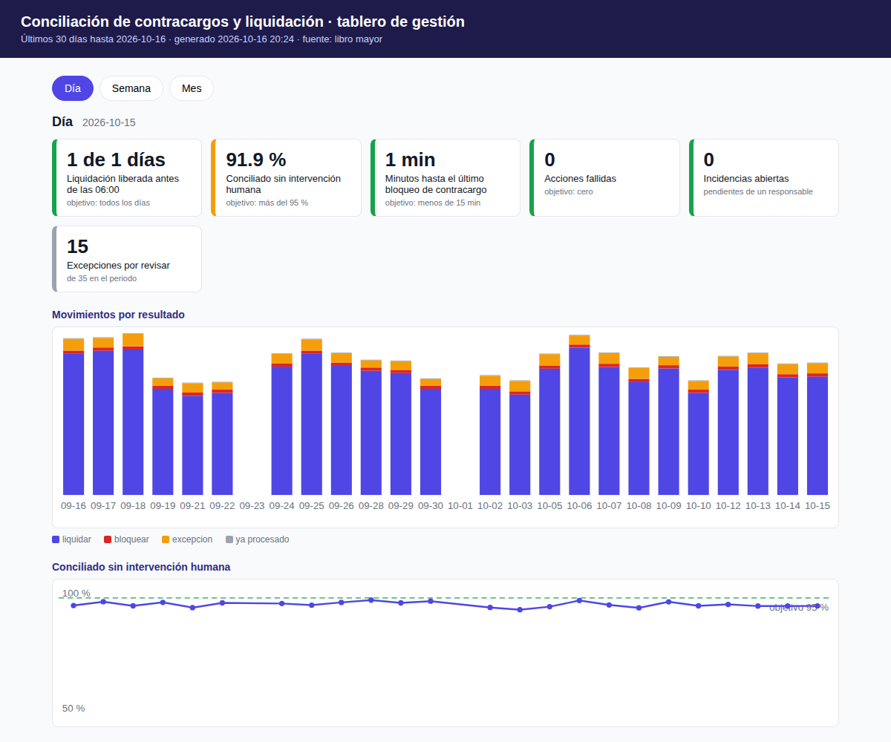

<div class="portada" markdown="1">
<div class="sup">Spin · Caso de negocio</div>

# Operación Escaldada

<div class="sub">Automatización end-to-end de contracargos y liquidación</div>

<div class="meta">
<b>Edgar Alberto Sanabria Paredes</b> · 16 de octubre de 2026<br>
Prototipo funcional: github.com/ragdeblacks/spin-conciliacion-contracargos<br>
ragdeblack@gmail.com · linkedin.com/in/edgarsanp
</div>

<div class="caja resumen" markdown="1">
**Situación.** Cada mañana un analista baja el CSV del portal del banco, lo cruza en Excel contra el Core de NetPay, libera liquidaciones por API y bloquea contracargos desde la interfaz del Core. El volumen creció 300 %.

**Complicación.** Mientras una persona esté en el camino crítico de cada transacción, más volumen significa más retraso, se contrate a quien se contrate. Además el banco cambia de portal en tres meses y libera una API en un año: una solución amarrada al portal de hoy habría que rehacerla dos veces.

**Respuesta.** Un proceso automático que corre cada madrugada y hace lo mismo que hoy hace el analista, con los mismos sistemas: baja el archivo del banco, lo cruza contra el Core, bloquea el saldo de los comercios que traen contracargo y después libera las liquidaciones que cuadran. La diferencia está en lo que pasa alrededor. Nada se ejecuta dos veces, todo queda registrado, y lo que no cuadra se aparta con un responsable mientras el resto sigue su camino. Las personas intervienen en dos momentos: para resolver excepciones y para aprobar montos altos. El portal del banco, su API futura y la interfaz del Core quedan detrás de piezas intercambiables, así que los cambios ya anunciados no obligan a rehacer nada. Entra a producción en tres fases, cada una con una condición clara para pasar a la siguiente. El prototipo corre completo contra simuladores y está en el repositorio.

En las páginas siguientes desarrollo los tres argumentos que lo sostienen: **protege el dinero por diseño**, **sobrevive a los cambios del banco y del Core** y **llega a producción sin sobresaltos**.
</div>
</div>

[[SALTO]]

## 1. Protege el dinero por diseño

Antes de ahorrar tiempo, el sistema tiene que garantizar una cosa: que ningún fallo suyo libere dinero que no debía salir ni deje un contracargo sin bloquear. Las decisiones de diseño que siguen existen para eso.

**Los dos escenarios del caso, tal como operan hoy, los ejecuta el sistema; la persona decide solo lo que tiene problema.** En el escenario A, cuando los datos coinciden según las reglas acordadas, el sistema llama la misma API REST interna de NetPay que hoy ejecuta el analista, con clave de idempotencia y rastro antes y después. En el escenario B, cuando el banco reporta un contracargo, el sistema entra a la pantalla del Core que hoy usa el analista y hace el mismo bloqueo de saldo que haría él, paso por paso, porque el Core no tiene una API para eso. De cada bloqueo guarda una captura de pantalla como evidencia. El bloqueo se ejecuta siempre, sin esperar a nadie, porque protege el dinero y no lo mueve. Lo único que espera una aprobación es liberar una liquidación de monto alto.

**Lo que tiene problema se aparta; todo lo demás avanza.** Así funcionan los procesos de conciliación: cada movimiento se decide por separado, lo que cuadra se liquida y lo que no, va a una cola con un responsable. Dentro de la corrida van primero los bloqueos y después las liquidaciones; un control (un *gate*, ver glosario) impide liberar mientras quede un bloqueo sin intentar. Un comercio que hoy queda bloqueado por contracargo no cobra en automático: sus ventas del día esperan a que una persona decida, y los demás comercios cobran. Si el bloqueo de un comercio falla, se apartan solo los pagos de ese comercio y se abre una incidencia. El proceso completo se detiene únicamente cuando no hay forma segura de hacer una parte: archivo del banco ilegible o con un volumen fuera de lo normal, Core sin responder o credenciales ausentes. Incluso entonces Operaciones puede cargar el archivo a mano y seguir.

**Ninguna acción se ejecuta dos veces.** Cada liquidación y cada bloqueo llevan una clave única derivada del movimiento. La clave viaja al Core en la cabecera de idempotencia y se guarda en un libro mayor propio, de solo inserción. Repetir una corrida, reanudarla después de un corte o correrla contra un Core que devuelve estados atrasados no libera ni bloquea nada de nuevo. Hay una prueba automatizada para cada uno de esos tres escenarios.

**El rastro se escribe antes de tocar el Core, y otra vez después.** El libro mayor registra la intención, después la confirmación o la falla. Si el proceso muere a la mitad, se sabe qué quedó en el aire. Cada decisión guarda la regla que la produjo, la respuesta del Core, la evidencia (captura de pantalla cuando la acción fue por interfaz) y el nombre de quien aprobó.

**Liberar un monto alto pasa por dos personas.** Una liquidación arriba del umbral que fije Operaciones queda pendiente hasta que un supervisor la aprueba con su nombre. Bloquear, en cambio, no espera a nadie: no mueve dinero.

**El sistema revisa lo que recibe antes de actuar.** Si el archivo del banco llega vacío, con columnas distintas o con el triple de movimientos que el promedio, la corrida se detiene antes de ejecutar nada. Al cierre comprueba que cada acción tenga un estado final; cualquier diferencia dispara una alerta. Los montos se manejan en centavos enteros, nunca en decimales.

La inteligencia artificial no participa en nada de lo anterior. Entra solo en la cola de excepciones, para sugerirle al analista una causa probable y una acción de una lista cerrada. Antes de enviarle nada, los identificadores se sustituyen por tokens. Si el modelo falla, no responde o se agota el presupuesto, hay una respuesta fija de respaldo. La sección 4 lo detalla.

Las credenciales viven en el gestor de secretos de la plataforma y llegan al contenedor como variables de entorno; si faltan o traen valores de relleno, el sistema no arranca. El robot usa un usuario de servicio propio, distinto del de los analistas, para que la auditoría del Core distinga a la máquina de la persona. Los archivos y las capturas se cifran en reposo, con la retención que defina Riesgos.

## 2. Sobrevive a los cambios del banco y del Core

El caso anuncia dos cambios; yo agrego un tercero que conviene pedir. Los tres se resuelven igual: lo que va a cambiar vive en un adaptador, fuera del núcleo, y se cambia con una variable de configuración.

<figure>

<figcaption>El núcleo solo conoce puertos. Cada sistema externo tiene su adaptador de hoy y, cuando aplica, el de mañana.</figcaption>
</figure>

| Cambio | Cuándo | Lo que se toca | Lo que no se toca |
|---|---|---|---|
| El banco cambia su portal | En 3 meses | Los selectores de pantalla, que son configuración, o el adaptador del portal. Una prueba de contrato diaria avisa el primer día que algo cambió. Mientras se ajusta, Operaciones sube el CSV a mano y el pipeline sigue | Reglas, libro mayor, ejecución, reporte |
| El banco libera su API | El próximo año | Se activa el adaptador de API, que el prototipo ya incluye contra una API simulada. Corre unas semanas en sombra junto al del portal, se comparan y se cambia la variable | Todo lo demás |
| El Core expone una API para bloquear | A negociar; es la primera petición que le haría al equipo del Core | Se activa el adaptador de API para bloqueo, que también existe ya, y se retira el robot sobre la interfaz | Todo lo demás |
| Cambia o se retira el modelo de IA | Cuando ocurra | La variable de modelo o de proveedor, después de pasar el set de evaluación | Todo lo demás |

Sobre el robot que opera el portal y la interfaz del Core: es la herramienta correcta mientras no haya API, y es frágil por naturaleza. Por eso cada acción deja captura, los selectores de pantalla son configuración y no código, y siempre existe el camino manual. Pedirle al equipo del Core una API de bloqueo es la primera tarea del roadmap: elimina la mitad del robot.

## 3. Llega a producción sin sobresaltos

Un proceso que corre en mi laptop no resuelve nada a las cinco de la mañana. Esta parte es la que, en mi experiencia, decide si una automatización se adopta o se abandona.

**Tres modos, una variable.** En modo *sombra* el sistema decide y registra, pero no toca el Core; después, un comando compara lo que habría hecho con lo que hizo el analista. En modo *asistido* todo queda pendiente y el supervisor aprueba en lote. En modo *autónomo* ejecuta dentro de los umbrales, y las personas solo ven excepciones y aprobaciones. Cambiar de modo no requiere despliegue y queda registrado en cada corrida.

| Fase | Semanas | Qué cambia | Para pasar a la siguiente |
|---|---|---|---|
| Discovery y MVP | 1 a 2 | Reglas extraídas del Excel y validadas con el analista; adaptador contra el portal real; despliegue en QA con un CSV real anonimizado | Operaciones aprueba las reglas |
| Sombra | 3 a 5 | Corre cada mañana en producción sin tocar dinero; comparación diaria contra el analista | Coincidencia mayor al 98 % durante tres semanas y cero falsos LIQUIDAR |
| Asistida | 6 a 8 | Ejecución real tras aprobación en lote; evidencia por acción; asistente de IA con proveedor real | Dos semanas sin fallas inexplicadas; aprobación en menos de 20 minutos |
| Autónoma | 9 a 12 | Ejecuta bajo umbrales | Las cuatro métricas de la tabla siguiente cumplidas dos semanas seguidas |
| Cambio de portal y API del banco | Mes 3 y cuando el banco la libere | Adaptador nuevo en sombra junto al viejo; cambio de variable | Coincidencia entre adaptadores mayor al 99.5 % |

| Métrica de éxito | Hoy | Objetivo |
|---|---|---|
| Hora en que queda liberada la liquidación del día | Cuando el analista termina | Antes de las 06:00 |
| Movimientos conciliados sin intervención humana | 0 % | Más del 95 % |
| Tiempo entre el reporte del contracargo y el bloqueo | Horas | Menos de 15 minutos desde la corrida |
| Liquidaciones duplicadas o a comercios con contracargo | Sin trazabilidad | Cero, con evidencia |

**Empaquetado y ejecución.** Un contenedor, construido sobre la imagen oficial de Playwright, configurado solo por variables de entorno e idéntico en desarrollo, QA y producción. Corre como tarea programada a las 05:00 (un CronJob de Kubernetes o el equivalente en la plataforma que use Spin), con reintento a las 05:20. Como es un proceso por lotes con estado en base de datos, repetirlo o reanudarlo no duplica nada. El libro mayor va en Postgres; la evidencia, en almacenamiento de objetos cifrado.

**Entrega continua.** Cada cambio pasa por lint, pruebas unitarias, pruebas de integración contra los simuladores, una prueba del robot con navegador real y la construcción de la imagen. Ese pipeline ya está en el repositorio. La misma imagen pasa a QA en automático y a producción con aprobación. Las reglas y los umbrales se cambian por el mismo camino que el código, con revisión de Operaciones; nunca a mano en producción.

**Observabilidad por fases.** Desde el primer día: registros con el identificador de corrida en cada línea, el resumen diario y las alertas en el canal de Slack de Operaciones, y un monitor externo (Healthchecks o Cronitor) al que el proceso le avisa cuando termina. Si a las 05:30 no ha avisado, el monitor alerta por su cuenta, aunque el proceso haya muerto sin decir nada. Las alertas críticas salen también por correo, que es lo que queda registrado y lo que Auditoría puede pedir. En la fase asistida se suma Sentry, para capturar errores no controlados con el contexto de la corrida y la versión desplegada, y Telegram para el supervisor de guardia, que a esa hora mira el celular antes que Slack. En la fase autónoma, las métricas de cada corrida (duración, acciones, excepciones, controles, consumo de tokens) van al tablero que Spin ya use, sea Datadog, Grafana u otro, con alertas por umbral y por cambios bruscos. Todos estos canales ya están en el prototipo detrás de un mismo puerto; activar uno es definir su variable.

| Si pasa esto | El sistema | Operaciones |
|---|---|---|
| El portal no responde o cambió | Detiene la corrida y alerta | Sube el CSV a mano y continúa; Tecnología ajusta los selectores |
| El Core no responde | Se detiene sin tocar nada y reintenta | Escala al equipo del Core; la corrida se repite después sin duplicar |
| Quedaron acciones fallidas al cierre | Las lista en el reporte | Las revisa, vuelve a correr o resuelve a mano y lo registra |
| El modelo de IA no responde | Usa la respuesta determinista | Nada |
| Hay que parar todo | Cambia a modo sombra o se suspende la tarea | Un comando del supervisor, sin despliegue |

**Cómo se ve la gestión.** Todo lo que el sistema decide, ejecuta, aparta o sugiere queda en el libro mayor con su hora. De ahí sale un tablero para el líder de Operaciones con semáforos contra objetivo y pestañas por día, semana y mes. Muestra las incidencias abiertas, con antigüedad y quién cerró cada una; el dinero apartado por comercio y por motivo (bloqueado hoy por contracargo, bloqueo fallido, doble control, umbral de riesgo), para atacar cada problema sabiendo cuánto libera; la cola de excepciones ordenada por riesgo y monto; y las excepciones que se repiten en un mismo comercio, candidatas a convertirse en regla. Cada corrida termina en uno de tres estados: cerrada, cerrada con incidencias (algo falló y quedó aislado con responsable) o detenida (uno de los tres casos de entrada). Cada falla abre una incidencia que alguien cierra con su nombre y una nota, y cada excepción se cierra registrando qué decidió el analista; con eso se mide si la sugerencia de la IA sirvió y cuánto tardó. En el prototipo el tablero es una página que se genera con un comando; en producción, las mismas consultas alimentan Grafana o Datadog.

<figure>

<figcaption>Tablero generado desde el libro mayor con 30 días simulados (semáforos, series por día y detalle; más abajo incidencias y excepciones).</figcaption>
</figure>

**Riesgos que veo.** El primero, que las reglas del analista sean más complejas de lo que parecen; por eso el discovery se hace con el analista y la fase sombra dura tres semanas. El segundo, que el Core rechace acciones por reglas internas que nadie documentó; cada rechazo queda como acción fallida, con incidencia y dinero apartado a la vista, sin frenar al resto, y de ahí sale una regla explícita. El tercero, que Operaciones no confíe en el sistema; para eso existen la comparación visible en sombra y la última palabra humana en asistida.

## 4. La evidencia

### El flujo diario y sus controles

Los nombres que empiezan con G- son los controles (gates) del pipeline. Cada uno se describe en el glosario al final del documento.

| Paso (05:00) | Control | Si falla |
|---|---|---|
| Arranque: credenciales desde el gestor, Core vivo | G-SECRETOS, G-CORE-VIVO | No se toca nada; alerta |
| Ingesta del CSV por el adaptador activo | G-ESQUEMA, G-VOLUMEN | Se detiene; carga manual |
| Conciliación con reglas explicables | G-DUPLICADO | |
| Bloqueo del saldo del comercio por cada contracargo (robot sobre la UI del Core) | Sin doble control (protector) | Acción fallida con incidencia; se apartan solo los pagos de ese comercio |
| Verificación de orden | G-ORDEN | No arrancan liquidaciones |
| Liquidaciones por la API interna, con idempotencia | G-UMBRAL | Acción fallida con incidencia; lo demás sigue |
| Triaje de excepciones con el asistente | G-LLM-PII, G-LLM-PRESUPUESTO | El analista trabaja sin sugerencia |
| Cierre, reporte y alertas | G-CIERRE, G-DERIVA, G-LATENCIA | Corrida "cerrada con incidencias" |

### Dónde entra la inteligencia artificial

| Determinista, siempre | Modelo de lenguaje | Nunca un modelo |
|---|---|---|
| Ingesta, validación, normalización, conciliación, clasificación, ejecución, idempotencia, umbrales, cierre, auditoría | Triaje de excepciones: causa probable, acción sugerida de un catálogo cerrado, confianza y una explicación corta. En discovery, extraer las reglas del Excel del analista. Resumen matutino | Decidir liberar o bloquear. Llamar al Core. Cambiar reglas sin una persona |

El modelo de referencia es Claude Sonnet 5.5; con cien excepciones diarias cuesta centavos al día. Va detrás de un puerto con tres adaptadores: Anthropic, cualquier servidor compatible con OpenAI (incluido un modelo abierto dentro del perímetro de Spin) y uno determinista. Cambiar de proveedor es una variable. Los prompts y el contexto de negocio están versionados en el repositorio. Antes de llamar al modelo, el comercio y la referencia se sustituyen por tokens, y un control busca patrones de tarjeta, CLABE, CURP y correo. La respuesta se valida contra un esquema; si no cumple, entra la respuesta determinista. Un conjunto de excepciones reales, resueltas por el analista, decide si un cambio de modelo o de prompt se despliega. Cada sugerencia queda registrada junto con lo que finalmente decidió la persona.

### El prototipo es una simulación controlada

Todos los resultados de este documento salieron de sistemas simulados que yo construí, no del banco ni del Core de NetPay. Hay que leer los números con eso en mente: prueban que la arquitectura funciona de punta a punta y que los controles hacen lo que dicen, no que las reglas reales de Spin ya estén capturadas. Eso se resuelve en la fase sombra, con datos reales.

**Qué se simula.** El portal web del banco (login, descarga del CSV, su API "del próximo año" y un modo que imita el cambio de portal anunciado) y el Core de NetPay (transacciones, liberación por API con clave de idempotencia, la interfaz de bloqueo y, detrás de una bandera, la API de bloqueo que se le pediría al equipo del Core). El conciliador es el real: el mismo código que se desplegaría, con los adaptadores apuntando a los simuladores.

**Cómo se muestrean los datos.** Un generador determinista produce, para cada fecha, las transacciones del Core y el archivo del banco de forma reproducible: misma fecha, mismos datos, en el portal y en el Core, sin archivo compartido. Cada día trae entre 190 y 560 ventas repartidas en 160 comercios, y siempre incluye los casos incómodos en proporción fija, para que ninguna prueba dependa de la suerte:

| Caso plantado cada día | Cuántos | Qué debe pasar |
|---|---|---|
| Ventas normales con match exacto | el grueso | Liquidar |
| Contracargos con match, uno parcial y uno sobre venta ya liquidada | 7 | Bloquear el saldo del comercio; sus ventas del día se apartan |
| Cuatro contracargos del mismo comercio | 4 | Bloquear y señalar el comercio como sobre el umbral de riesgo |
| Contracargo sin venta en el Core | 1 | Excepción de máxima prioridad e incidencia |
| Monto distinto entre banco y Core | 3 | Excepción |
| Referencia sin match, con y sin candidatos parecidos | 2 | Excepción con candidatos para el analista |
| Movimiento duplicado en el archivo | 2 | Uno se procesa, el otro es excepción |
| Venta ya liquidada por el analista | 2 | Ya procesado, sin tocar |
| Fecha fuera de tolerancia y fecha con desfase tolerado | 2 | Excepción y liquidar, respectivamente |
| Moneda distinta, venta de comercio suspendido, liquidación de $75,000 | 3 | Excepción, excepción, doble control |
| Ventas que el banco reportará mañana | 8 | Nada hoy |

Para el tablero se simularon además 30 días completos siguiendo el plan de adopción (diez en sombra, diez en asistida con aprobaciones, diez en autónoma) con tres fallas plantadas: un día con el Core caído, un día con el portal cambiado y una liberación rechazada, más las resoluciones que harían los analistas.

**Cómo el sistema señala mejoras.** La simulación sirvió también para probar que el diseño aprende de la operación. Lo hace por cuatro vías que ya funcionan en el código:

1. Todo rechazo del Core o del banco queda como acción fallida con la respuesta guardada, abre una incidencia y aparta solo el dinero afectado. En la simulación se plantó una liberación rechazada y un bloqueo fallido para comprobar que el resto de la corrida sigue y que el problema queda visible con su monto.
2. Las excepciones que se repiten con el mismo motivo en el mismo comercio aparecen en el tablero como candidatas a regla nueva; cuando el analista las resuelve siempre igual, la regla se escribe, se prueba y se despliega por el mismo camino que el código.
3. La comparación en modo sombra mide cada día cuánto coincide el sistema con el analista y señala exactamente en qué movimientos difiere: ahí es donde se calibran tolerancias y umbrales con Operaciones.
4. El control de deriva avisa cuando la tasa de excepciones se dispara, que es la señal temprana de que el banco o el Core cambiaron algo.

El repositorio incluye el conciliador completo, los dos simuladores, el generador de datos, 41 pruebas automatizadas, Docker Compose y el pipeline de integración continua.

| Corrida contra los simuladores (Docker Compose) | Resultado |
|---|---|
| Sombra, 1 s | 186 movimientos: 158 a liquidar, 11 a bloquear, 15 apartados o excepciones con sugerencia, 2 ya procesados. No tocó el Core |
| Autónoma, 17 s en contenedores | 169 acciones: 11 bloqueos por la interfaz del Core con captura de evidencia y 158 liquidaciones por la API interna. Una liquidación de monto alto quedó en doble control, un supervisor la aprobó y se ejecutó |
| Comparación sombra contra Core | 169 de 169 coincidencias |

Lo que el prototipo todavía no cubre: corre contra servicios simulados, el libro mayor es SQLite y las pruebas usan el adaptador determinista de IA para no depender de una llave ni gastar en integración continua. Los adaptadores reales existen y están validados contra el esquema.

```
make instalar && make mocks      # dependencias, navegador y servicios simulados
make demo                        # corrida en modo sombra
MODO=autonoma make demo          # corrida autónoma
```

<div class="glosario" markdown="1">

## Glosario

**Términos**

| Término | Significado en este documento |
|---|---|
| Adquirente | Banco que procesa los pagos con tarjeta de los comercios de Spin y reporta cada día ventas y contracargos |
| Contracargo | Reversión de una venta por disputa del tarjetahabiente. El adquirente cobra al comercio el importe más una comisión |
| Liquidación | Liberar al comercio el dinero de sus ventas conciliadas |
| Bloqueo de saldo | Operación del Core, hoy solo por su interfaz, que impide liberar dinero a un comercio tras un contracargo. Lo quita una persona |
| Procesamiento por excepciones | Forma de operar en la que lo que está limpio se ejecuta y lo que tiene problema se aparta con dueño, sin detener el resto |
| Dinero apartado | Pagos que no salieron porque esperan a una persona: comercio bloqueado hoy, bloqueo fallido, doble control o umbral de riesgo. El tablero lo muestra por comercio y motivo |
| Comercio en riesgo | Comercio que supera los umbrales de contracargos (por día o por ratio en 30 días); señal para que Riesgos lo revise |
| Estados de una corrida | Cerrada: todo con estado final. Cerrada con incidencias: algo falló y quedó aislado con dueño. Detenida: archivo ilegible o anómalo, Core sin responder o credenciales ausentes |
| Conciliación | Cruce de cada movimiento del banco contra el Core para decidir liquidar, retener, revisar o nada |
| Excepción | Movimiento que las reglas no pudieron clasificar; lo resuelve un analista, con sugerencia del asistente |
| Incidencia | Registro de algo que salió mal (corrida detenida, acción fallida, contracargo sin match) con dueño, estado y antigüedad |
| Doble control | Aprobación de un supervisor, con nombre registrado, antes de ejecutar una acción |
| Idempotencia | Repetir una acción no produce efecto adicional: no se libera ni se bloquea dos veces |
| Libro mayor | Registro propio, de solo inserción, de corridas, decisiones, acciones, controles, aprobaciones, incidencias y sugerencias |
| Puerto y adaptador | El puerto es la interfaz que el núcleo conoce; el adaptador, la implementación concreta (portal, API, interfaz) que se cambia sin tocar el núcleo |
| RPA | Automatización que opera una interfaz de usuario como lo haría una persona; útil sin API, frágil ante cambios de pantalla |
| Gate | Control que detiene el pipeline si no se cumple. Crítico: protege dinero y bloquea. No crítico: protege calidad y solo alerta o degrada |
| Modo sombra | El sistema decide y registra sin ejecutar; se compara después con lo que hizo la persona |
| Triaje | Sugerencia del asistente de IA para una excepción: causa probable, acción de un catálogo cerrado y confianza |
| Tokenización | Sustituir identificadores (comercio, referencia, tarjeta) por tokens opacos antes de enviar algo al modelo |
| Dead man's switch | Monitor que alerta si no recibe el latido del pipeline a tiempo, aunque el proceso haya muerto sin avisar |

**Controles del pipeline (gates)**

| Control | Qué verifica | Crítico |
|---|---|---|
| G-FECHA | Que la fecha de operación sea anterior a hoy | Sí |
| G-SECRETOS | Que las credenciales existan, vengan del entorno y no sean valores de relleno | Sí |
| G-CORE-VIVO | Que el Core responda antes de tocar nada | Sí |
| G-ESQUEMA | Que el archivo del banco traiga las columnas, tipos y moneda esperados | Sí |
| G-VOLUMEN | Que el archivo no venga vacío ni con más del triple del promedio histórico | Sí |
| G-DUPLICADO | Que no se repita una acción ya confirmada en una corrida anterior | Sí |
| G-UMBRAL | Que una liquidación arriba del umbral pase por doble control | Sí |
| G-ORDEN | Que ninguna liquidación arranque con un bloqueo sin intentar | Sí |
| G-CIERRE | Que toda acción termine con estado final consistente; si no, la corrida cierra "con incidencias" | No |
| G-CONTRATO-PORTAL | Que el portal del banco siga teniendo los elementos que usa el robot | No |
| G-SOMBRA | Que la coincidencia con el analista supere el umbral antes de cambiar de fase | No |
| G-LLM-PII | Que el paquete enviado al modelo no contenga datos personales sin tokenizar | No |
| G-LLM-PRESUPUESTO | Que el consumo del modelo esté bajo el tope por corrida y por día | No |
| G-DERIVA | Que la tasa de excepciones del día esté dentro del rango histórico | No |
| G-LATENCIA | Que la corrida termine antes de las 06:00 | No |

</div>
